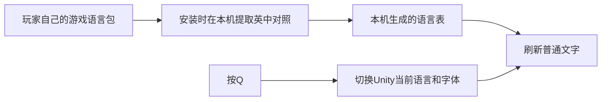

# Probably Stolen · Q中英文切换

**在《深空当铺：可能是偷得》试玩版里按Q切换中英文，让读剧情和学英语更方便。**

[下载最新版本](https://github.com/ananshangyuan-source/probably-stolen-language-toggle/releases/latest) · [安装与排错](docs/INSTALL.md) · [实现原理](docs/DEVELOPMENT.md) · [反馈问题](https://github.com/ananshangyuan-source/probably-stolen-language-toggle/issues/new/choose) · [English](docs/README.en.md)

## 快速开始

1. 从上面的下载页下载 **`ProbablyStolen-LanguageToggle-v1.0.3-Windows-x64.zip`**。
2. 解压到一个准备长期保留、当前账号可写的文件夹。请先保存并退出游戏。
3. 双击 **`Install.cmd`**，等待依赖下载和安装完成。
4. 照常通过Steam启动试玩版，进入菜单后等约5秒，按 **Q** 切换英文 / 简体中文。

安装器会自动查找Steam游戏目录。找不到时会弹出选文件夹窗口：选择包含 `Probably Stolen.exe` 的试玩版目录。

**安装后不要移动或删除解压文件夹。** 游戏的加载器会引用这里的运行环境；要迁移位置，请先卸载，再在新位置重新安装。

> 首次安装需要联网访问BepInEx、GitHub和PyPI。首次启动还需要BepInEx下载匹配的Unity基础库并生成互操作程序集，等待时间会比平时长。初始化完成后，本MOD的语言切换本身不需要网络、API密钥或本地大模型。

## 它能做什么

- 按Q在游戏已有的英文和简体中文之间切换。
- 刷新大部分当前显示的普通文字，并更新游戏语言状态与相应字体。
- 输入框获得焦点时，Q保持正常输入用途。
- 无云端翻译、无遥测，不主动编辑存档；游戏自己的正常保存行为仍由游戏负责。
- 提供自动安装、启用、停用和卸载脚本。

### 当前限制

- **部分已打开的物品窗口需要关闭后重新打开。** MOD保留这些窗口的原生富文本，不强行替换物品类别文字。
- 游戏语言表里原本缺少中文的内容仍显示英文，不会凭空补译。
- 不保证所有动态文字、格式化句子或特殊窗口立即刷新。
- Q是固定按键；尚未提供改键界面，与其他占用Q的MOD可能冲突。
- 仅验证下表中的Windows试玩版。正式版、其他版本和其他MOD组合未验证。

## 兼容性

| 项目 | 已验证配置 |
| --- | --- |
| 游戏 | Probably Stolen Demo / Steam AppID `4349200` |
| 游戏构建 | `25382790`，游戏版本 `049-Rev5-L` |
| 引擎 | Unity `2021.3.45f2` / IL2CPP / x64 |
| MOD | `1.0.3` |
| 加载器 | BepInEx `6.0.0-be.788+5b766a3`，Unity IL2CPP Windows x64 |
| 系统验证 | Windows 11 x64；Windows 10 x64未实机验证 |

其他构建默认会提示尚未测试。游戏更新后如果出现报错，先停用MOD并反馈版本，避免反复启动。

## 停用和删除

先保存并退出游戏，然后：

| 操作 | 双击文件 | 结果 |
| --- | --- | --- |
| 暂时停用 | `Disable.cmd` | 下次启动不加载MOD，保留运行环境 |
| 再次启用 | `Enable.cmd` | 下次启动恢复加载 |
| 完全卸载 | `Uninstall.cmd` | 删除本MOD添加的3个加载器文件，以及此文件夹里的运行环境、生成语言表和缓存 |

卸载成功后可以删除整个解压文件夹。卸载器会核对文件归属及哈希；如果文件已被其他MOD修改，会保留文件并提示，不会直接覆盖或删除。

游戏目录只新增 `winhttp.dll`、`doorstop_config.ini`、`.doorstop_version`。**游戏EXE、GameAssembly、UnityPlayer、原语言包与存档不由安装器修改。**

## 工作原理

源码和下载包均不包含游戏语言表或游戏程序集。安装时使用UnityPy读取玩家自己安装的试玩版，生成本机专用的 `language-pairs.json`，只保存在本地。请勿把该文件或生成的互操作程序集上传到GitHub或问题反馈中。

具体的加载方式、为何保留物品窗口原生显示，以及如何从源码编译，见[开发文档](docs/DEVELOPMENT.md)。

## 反馈与参与

欢迎提交[问题报告](https://github.com/ananshangyuan-source/probably-stolen-language-toggle/issues/new/choose)或PR。报告请包含游戏BuildID、MOD版本、问题出现在哪个窗口，以及最短复现步骤。不要上传完整存档、完整日志、语言表或游戏DLL；日志可只粘贴必要错误，并删除个人路径。

项目由实际使用需求发起，开发过程使用了Codex辅助。当前运行逻辑1.0.3已由玩家实机确认：Q切换可用，物品类别英文显示正常。自动安装与卸载另有隔离测试，测试范围见[更新记录](CHANGELOG.md)。

## 授权与致谢

本项目自己的源码和脚本以[MIT许可证](LICENSE)发布。它是非官方社区MOD，与游戏开发者和发行商无隶属关系；游戏内容和商标归原权利人所有。

依赖从各自官方来源下载，不捆绑在本项目下载包中。感谢[BepInEx](https://github.com/BepInEx/BepInEx)、[UnityPy](https://github.com/K0lb3/UnityPy)、[Python](https://www.python.org/)和[uv](https://github.com/astral-sh/uv)。依赖授权说明见[THIRD_PARTY_NOTICES.md](THIRD_PARTY_NOTICES.md)。

本项目遵循[该游戏的MOD发布规则](https://github.com/dragonpan2/probably-stolen-modding/blob/main/CodeOfConduct.md)：不重新分发游戏源码、素材或语言表。
